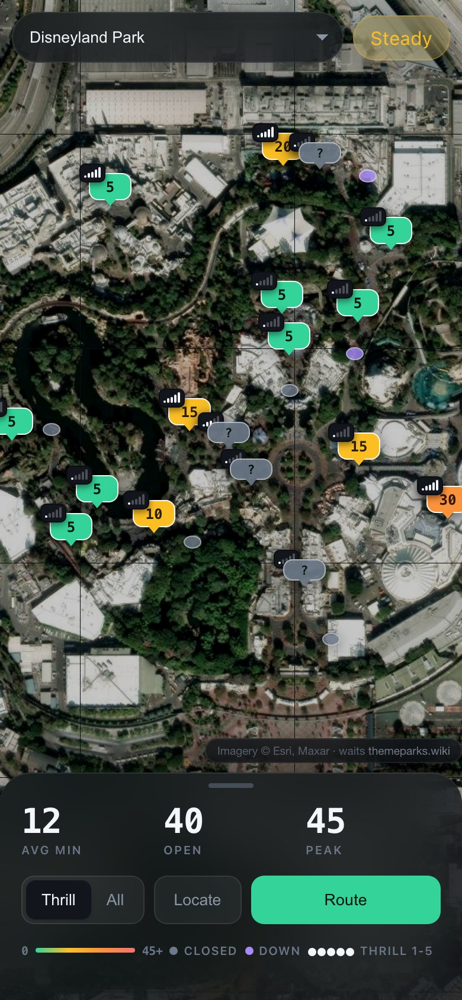
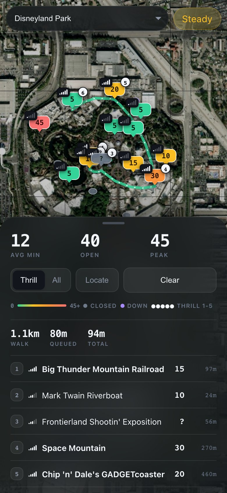
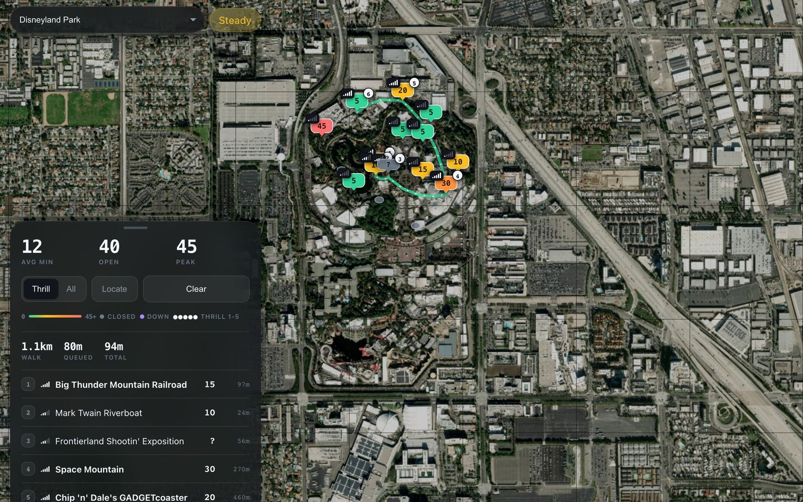

<div align="center">

<h1>Park Waits</h1>

<p><b>Live ride waits, pinned on a satellite map.</b></p>

<p><i>A list of wait times can't tell you the 5-minute ride is on the far side of the park. A map can.</i></p>

<h6>


</h6>

<a href="https://parkwaits.pages.dev"><b>Live demo</b></a> ·
<a href="#how-it-works"><b>How it works</b></a> ·
<a href="#features"><b>Features</b></a> ·
<a href="#run-it"><b>Run it</b></a>

<br><br>

<a href="https://parkwaits.pages.dev"></a>&nbsp;&nbsp;&nbsp;<a href="https://parkwaits.pages.dev"></a>

<sub>Live Disneyland Park data on an October afternoon, captured from parkwaits.pages.dev on a 390-pixel phone viewport.</sub>

</div>

<br>

## The problem

Park apps and wait-time sites give you a list sorted by name or by minutes. Standing in a park,
the question is different: what is short, what is near me, and in what order should I walk it.
Park Waits puts every ride's current standby time on the satellite map where it stands, then
plans a walking loop that weighs the queue against the walk.

## How it works

<table>
<tr>
<td width="33%" valign="top">

**1 · Pick a park**

The picker lists every park on [ThemeParks.wiki](https://themeparks.wiki), about 200 of them.
The choice goes into the URL (`#p=<park id>`), so a link opens straight to that park.

</td>
<td width="33%" valign="top">

**2 · Read the map**

Each open ride is a pin showing its standby minutes, coloured green under 10, amber under 25,
orange under 45 and red above. Closed rides are grey dots, rides that are down are purple.

</td>
<td width="33%" valign="top">

**3 · Tap Route**

It builds a walking order from your location, or from the gate if you don't share it: thrill
rides first, each leg costed by walking time plus the queue. Tap a stop to tick it off and the
rest re-plans.

</td>
</tr>
</table>

## On a laptop

<div align="center">

<a href="https://parkwaits.pages.dev"></a>

<sub>The same live data at 1280 × 800. On wide screens the sheet docks to the left instead of sliding up from the bottom.</sub>

</div>

## Features

- **Live, and stays live.** Waits come from the ThemeParks.wiki `/live` feed, refresh every 90
  seconds, and refresh again when you come back to the tab.
- **Crowd at a glance.** Average wait, rides open and the peak wait sit at the top of the sheet,
  and a pill rates the park from Empty through Quiet, Steady and Busy to Packed.
- **Thrill meter on every pin.** A 1 to 5 bar rating, from a hand-made table for Six Flags
  Discovery Kingdom and a keyword rule set (coaster, drop tower, flume, carousel...) for every
  other park.
- **A route worth walking.** Greedy nearest-neighbour, then a 2-opt pass to uncross the loop.
  Each leg costs walk time at 1.35 m/s plus the standby wait, with a bonus for bigger rides.
- **Thrill or All.** Route only rides rated 3 and up, or everything that is running.
- **Recheck list.** Thrill rides that are closed or down are listed under the route, so you know
  what to look at again later.
- **Follows you.** Locate tracks your GPS position, re-plans the route as you move and shows each
  ride's distance in its popup. Any popup can also start a route from that ride.
- **Readable pins.** When pins overlap, the more useful one wins: route stops, then thrill rides,
  then rides with a known wait.
- **Single rider times** in the popup when a park reports them. Light and dark follow your system.

## Run it

No build step, no keys, no dependencies to install. Leaflet loads from unpkg and the data comes
straight from the public ThemeParks.wiki API.

```bash
git clone https://github.com/parthchandak02/parkwaits.git
cd parkwaits
python3 -m http.server 8000   # then open http://localhost:8000
```

Opening `index.html` directly also works. To deploy, `dist/` holds a copy of the page for
Cloudflare Pages:

```bash
cp index.html dist/ && npx wrangler pages deploy dist --project-name parkwaits
```

<details>
<summary><b>Project layout and data</b></summary>

```
index.html        The whole app: styles, map, data fetching, routing
dist/index.html   The copy that is deployed to Cloudflare Pages
```

| Source | Used for |
|---|---|
| `api.themeparks.wiki/v1/destinations` | The park list |
| `/entity/{park}/children` | Ride coordinates |
| `/entity/{park}/live` | Status, standby and single-rider waits |
| Esri World Imagery | Satellite tiles |

Rides without coordinates in ThemeParks.wiki don't appear on the map. Parks open at the moment
you look show coloured pins; a closed park shows a field of grey dots.

</details>

<br>

<div align="center">
<sub>Built with Leaflet and plain JavaScript. Wait times from ThemeParks.wiki, imagery from Esri.</sub>
</div>
